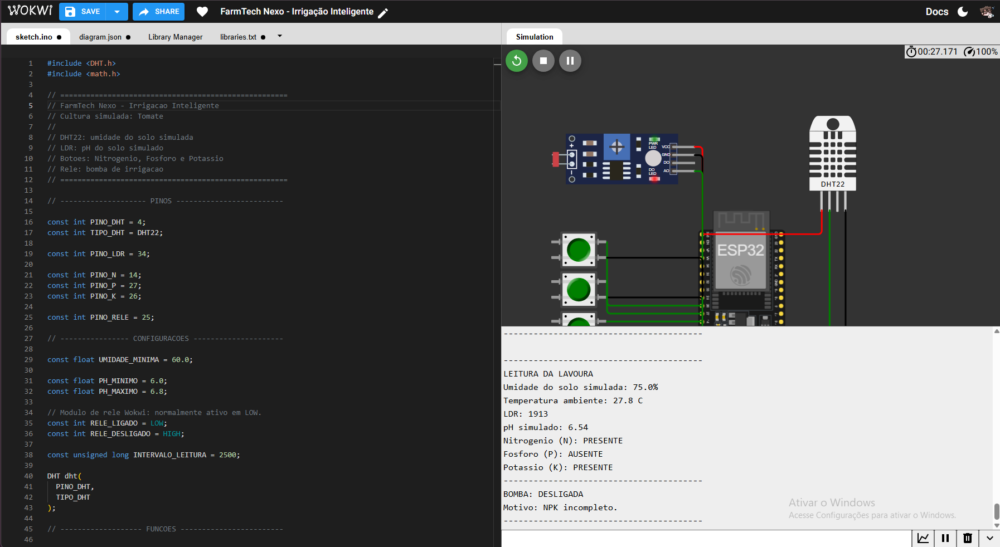
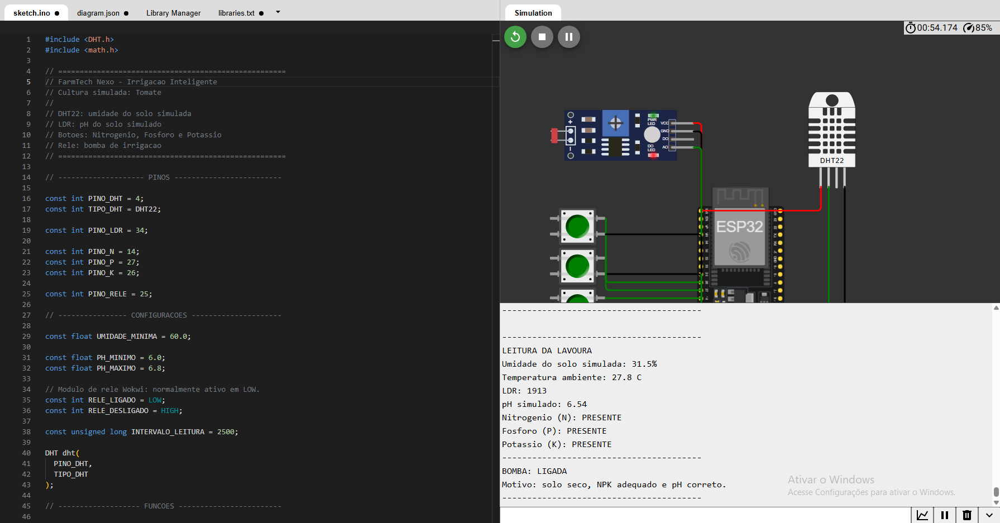

# 🌱 FarmTech Nexo

> Sistema inteligente de irrigação para agricultura de precisão, desenvolvido com ESP32 e simulado no Wokwi.

## Sobre o projeto

O **FarmTech Nexo** é um projeto acadêmico desenvolvido para a FarmTech Solutions. A solução simula um sistema de irrigação automatizado capaz de analisar condições do solo e decidir quando acionar uma bomba d'água.

O projeto utiliza sensores e componentes simulados no Wokwi para representar variáveis agrícolas importantes: umidade do solo, pH e disponibilidade dos nutrientes Nitrogênio, Fósforo e Potássio (NPK).

A finalidade é reduzir desperdícios de água e demonstrar como sensores, automação e IoT podem apoiar decisões na agricultura de precisão.

---

## Objetivo

Desenvolver um sistema de irrigação inteligente utilizando ESP32 que:

- Monitora a umidade do solo em tempo real.
- Avalia o pH do solo por meio de uma simulação com LDR.
- Verifica a disponibilidade de N, P e K por meio de três botões.
- Aciona um relé, representando uma bomba d'água, somente quando todas as condições de irrigação forem atendidas.
- Exibe leituras e decisões no Monitor Serial do Wokwi.

---

## Cultura simulada

A cultura escolhida para a simulação foi o **tomate**.

Para fins didáticos, o sistema considera que a irrigação só pode ocorrer quando:

| Critério | Regra definida |
|---|---|
| Umidade simulada | Menor que 60% |
| Nitrogênio | Botão N pressionado |
| Fósforo | Botão P pressionado |
| Potássio | Botão K pressionado |
| pH simulado | Entre 6,0 e 6,8 |

> A lógica representa uma simplificação didática e não substitui uma recomendação agronômica profissional.

---

## Componentes utilizados

| Componente | Quantidade | Papel no projeto |
|---|---:|---|
| ESP32 DevKit V1 | 1 | Microcontrolador responsável pela leitura e decisão |
| DHT22 | 1 | Representa didaticamente a umidade do solo |
| LDR | 1 | Representa didaticamente o pH do solo |
| Pushbutton verde | 3 | Representam Nitrogênio, Fósforo e Potássio |
| Módulo relé | 1 | Representa a bomba de irrigação |
| Jumpers | - | Realizam as conexões do circuito |

---

## Substituições didáticas

Como o ambiente Wokwi não disponibiliza sensores agrícolas específicos para NPK e pH do solo, foram adotadas as seguintes simulações:

| Variável agrícola real | Componente utilizado no Wokwi | Funcionamento na simulação |
|---|---|---|
| Nitrogênio (N) | Botão verde | Pressionado = presente; solto = ausente |
| Fósforo (P) | Botão verde | Pressionado = presente; solto = ausente |
| Potássio (K) | Botão verde | Pressionado = presente; solto = ausente |
| pH do solo | LDR | Leitura analógica convertida didaticamente para escala de pH de 0 a 14 |
| Umidade do solo | DHT22 | Valor de umidade do ar usado como umidade do solo simulada |
| Bomba d'água | Relé azul | Ligado = irrigação ativa; desligado = irrigação interrompida |

---

## Conexões do circuito

| Componente | Pino do componente | GPIO / pino ESP32 |
|---|---|---|
| DHT22 | VCC | 3V3 |
| DHT22 | SDA | GPIO 4 |
| DHT22 | GND | GND |
| LDR | VCC | 3V3 |
| LDR | AO | GPIO 34 |
| LDR | GND | GND |
| Botão N | Sinal | GPIO 14 |
| Botão N | Retorno | GND |
| Botão P | Sinal | GPIO 27 |
| Botão P | Retorno | GND |
| Botão K | Sinal | GPIO 26 |
| Botão K | Retorno | GND |
| Relé | VCC | 5V |
| Relé | IN | GPIO 25 |
| Relé | GND | GND |

---

## Lógica de decisão

O sistema executa leituras periódicas dos sensores e avalia as condições abaixo.

```text
SE a leitura do DHT22 for inválida
    Desligar a bomba por segurança

SENÃO SE N, P ou K estiverem ausentes
    Manter a bomba desligada

SENÃO SE o pH simulado estiver fora da faixa de 6,0 a 6,8
    Manter a bomba desligada

SENÃO SE a umidade simulada estiver abaixo de 60%
    Ligar a bomba de irrigação

SENÃO
    Manter a bomba desligada por umidade suficiente
```

A conversão didática da leitura do LDR para pH é realizada pela fórmula:

```text
pH simulado = (leitura do LDR × 14) / 4095
```

---

## Estrutura do repositório

```text
Farmtech-Nexo-Irrigacao-Inteligente/
├── README.md
├── wokwi/
│   ├── diagram.json
│   ├── libraries.txt
│   └── sketch.ino
└── docs/
    └── imagens/
        ├── circuito-completo.png
        ├── bomba-desligada-npk.png
        ├── bomba-desligada-ph.png
        ├── bomba-desligada-umidade.png
        └── bomba-ligada.png
```

---

## Como executar

1. Abra o simulador [Wokwi](https://wokwi.com/).
2. Crie ou abra um projeto ESP32.
3. Copie os arquivos da pasta `wokwi/` deste repositório:
   - `sketch.ino`
   - `diagram.json`
   - `libraries.txt`
4. Inicie a simulação.
5. Abra o Monitor Serial.
6. Ajuste a umidade e o LDR.
7. Pressione ou solte os botões N, P e K.
8. Observe a decisão apresentada no Monitor Serial e o estado do relé.

---

## Cenários de teste

### 1. NPK incompleto

Configuração:

```text
Umidade: 31%
pH: entre 6,0 e 6,8
Ao menos um botão N, P ou K solto
```

Resultado esperado:

```text
BOMBA: DESLIGADA
Motivo: NPK incompleto.
```



### 2. pH inadequado

Configuração:

```text
Umidade: 31%
N, P e K: presentes
pH: fora da faixa entre 6,0 e 6,8
```

Resultado esperado:

```text
BOMBA: DESLIGADA
Motivo: pH simulado fora da faixa ideal.
```


### 3. Umidade suficiente

Configuração:

```text
Umidade: 75%
N, P e K: presentes
pH: entre 6,0 e 6,8
```

Resultado esperado:

```text
BOMBA: DESLIGADA
Motivo: umidade do solo suficiente.
```


### 4. Irrigação ativada

Configuração:

```text
Umidade: 31%
N, P e K: presentes
pH: entre 6,0 e 6,8
```

Resultado esperado:

```text
BOMBA: LIGADA
Motivo: solo seco, NPK adequado e pH correto.
```



---

## Circuito no Wokwi


Link da simulação:

```text
https://wokwi.com/projects/477776864934983681
```

---

## Código-fonte

O código C/C++ do ESP32 está disponível em:

```text
wokwi/sketch.ino
```

A biblioteca utilizada pelo sensor DHT22 está registrada em:

```text
wokwi/libraries.txt
```

---

## Vídeo demonstrativo

O vídeo de demonstração possui até cinco minutos e apresenta:

- O circuito montado no Wokwi.
- O papel de cada componente.
- A lógica de decisão da irrigação.
- Os cenários com a bomba desligada.
- O cenário com a bomba ligada.
- A leitura exibida no Monitor Serial.

Link do vídeo não listado:

```text

```

---

## Integrantes

| Nome | RM |
|---|---|
| Guilherme Cabral Mendes Mariano | 574221 |

---

## Observações

Este projeto foi desenvolvido para fins acadêmicos e utiliza substituições didáticas no ambiente de simulação Wokwi. As faixas e regras adotadas demonstram o funcionamento lógico do sistema, mas não substituem análise de solo, sensores agrícolas calibrados ou orientação de profissionais da área agronômica.
